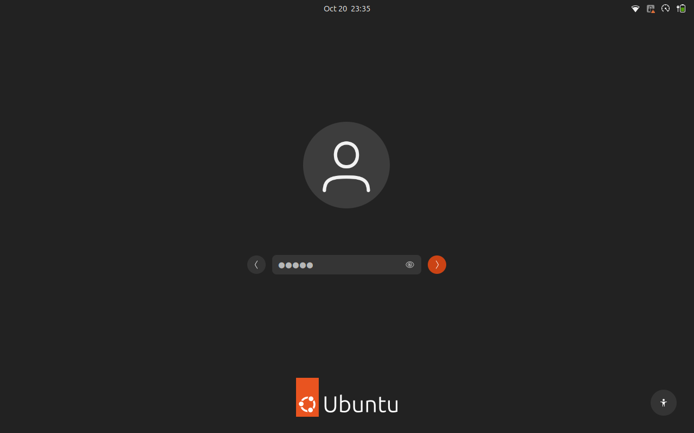
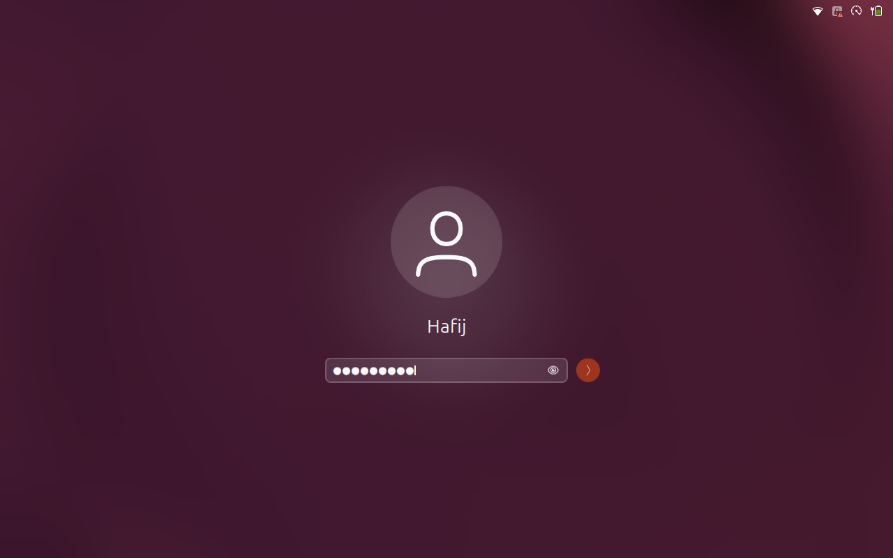

# GNOME Sign-In Button

A GNOME Shell extension that adds a clickable sign-in arrow next to the
password field on the **GDM login screen** and the **lock screen**.

GNOME's login and unlock prompts only accept the <kbd>Enter</kbd> key. This
extension puts a round accent-coloured **➜** button where the spinner normally
sits, so you can submit your password with the mouse or a touchscreen.

| Login screen (GDM) | Lock screen |
| --- | --- |
|  |  |

## Features

- Works on the GDM greeter (before login) and on the lock screen.
- The button appears as soon as you type and hides when the field is empty.
- A click does exactly what <kbd>Enter</kbd> does. The usual spinner takes
  the button's place while GNOME checks your password.
- Uses the theme's accent colour and the stock login button style.
- No settings and no background processes. It only changes the auth prompt.

## Requirements

- GNOME Shell **50** (tested on Ubuntu 26.04 LTS, GNOME 50.1, Wayland)
- GDM as the display manager (for the login screen part)
- `sudo` rights (the login screen runs as the `gdm` user, so the extension
  must be installed system-wide)

## Installation

1. Get the code:

   ```bash
   git clone https://github.com/Hafij-DEU/gnome-signin-button.git
   cd gnome-signin-button
   ```

2. Install system-wide and enable it on the login screen:

   ```bash
   sudo ./install.sh
   ```

   This copies the extension to
   `/usr/share/gnome-shell/extensions/signin-button@hafij-deu.github.io`,
   writes `/usr/share/gdm/dconf/95-signin-button` (enables it for the `gdm`
   user) and recompiles the greeter settings.

3. Enable it for your own lock screen:

   ```bash
   gsettings set org.gnome.shell enabled-extensions "$(gsettings get org.gnome.shell enabled-extensions | sed "s/]$/, 'signin-button@hafij-deu.github.io']/; s/^@as \[, /[/")"
   ```

   On Wayland the running GNOME Shell does not see a newly installed
   extension until you log in again, so `gnome-extensions enable` reports
   *"does not exist"* right after install. The command above adds it to the
   enabled list directly. After the next login, `gnome-extensions enable`
   works too.

4. Log out and back in (on Wayland GNOME only loads new extensions at login).
   The login screen shows the button from the next logout or reboot.

### Lock screen only (no sudo)

If you only want the button on the lock screen, install it for your user:

```bash
mkdir -p ~/.local/share/gnome-shell/extensions
cp -r signin-button@hafij-deu.github.io ~/.local/share/gnome-shell/extensions/
```

Log out and back in, then run:

```bash
gnome-extensions enable signin-button@hafij-deu.github.io
```

## Updating

```bash
cd gnome-signin-button
git pull
sudo ./install.sh
```

Log out and back in afterwards.

## Uninstall

```bash
sudo ./uninstall.sh
gnome-extensions disable signin-button@hafij-deu.github.io
```

For a user-only install, delete
`~/.local/share/gnome-shell/extensions/signin-button@hafij-deu.github.io`
instead.

## Troubleshooting

- **No button on the login screen:** check the greeter setting was compiled:

  ```bash
  cat /usr/share/gdm/dconf/95-signin-button
  sudo /usr/share/gdm/generate-config
  ```

  Then reboot. If another `enabled-extensions` value is set for the `gdm`
  user elsewhere, add `signin-button@hafij-deu.github.io` to that list too.
- **No button on the lock screen:** confirm it is enabled and active:

  ```bash
  gnome-extensions info signin-button@hafij-deu.github.io
  ```

- **Errors:** read the shell log:

  ```bash
  journalctl -b /usr/bin/gnome-shell | grep -i signin
  ```

## How it works

Both the login dialog and the unlock dialog use GNOME's
`gdm/authPrompt.js`. The extension wraps `AuthPrompt._initInputRow` and adds
an `St.Button` to the prompt's default button well. A click calls the
entry's own `activate`, so the password goes through the normal GNOME and
PAM code path. Nothing is stored or logged.

## License

GPL-2.0-or-later. See [LICENSE](LICENSE).

Author: Md Hafijur Rahman
